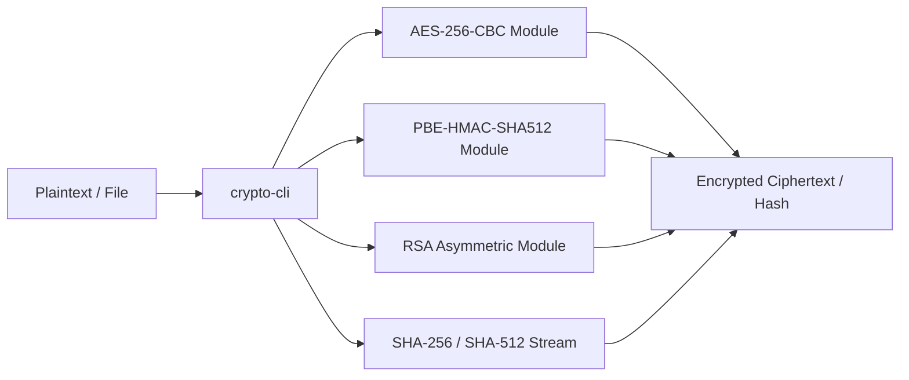

# Crypto Util

> A lightweight CLI utility for symmetric encryption, asymmetric keypair operations, and deterministic hashing.

[](LICENSE)
[](https://github.com/samuelj90/crypto-util/actions/workflows/ci.yml)

---

## Architecture Overview



---

## Features

- **AES-256-CBC**: Symmetric encryption and decryption with initialization vectors.
- **PBEWithHMACSHA512AndAES_128**: Password-based key derivation encryption.
- **RSA**: Public key encryption and private key decryption.
- **Hashing**: Deterministic cryptographic digests using SHA-256 and SHA-512.

---

## Installation & Setup

```bash
# Clone the repository
git clone https://github.com/samuelj90/crypto-util.git
cd crypto-util

# Install dependencies
npm install
```

---

## Verification & Testing

Run the deterministic test suite:

```bash
npm test
```

---

## Security

Please report vulnerabilities following our [Security Policy](SECURITY.md).

---

## License

[MIT License](LICENSE)
